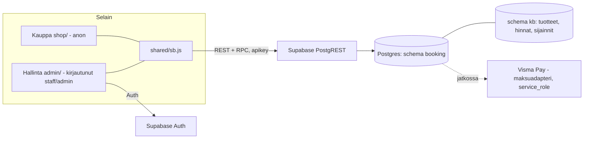
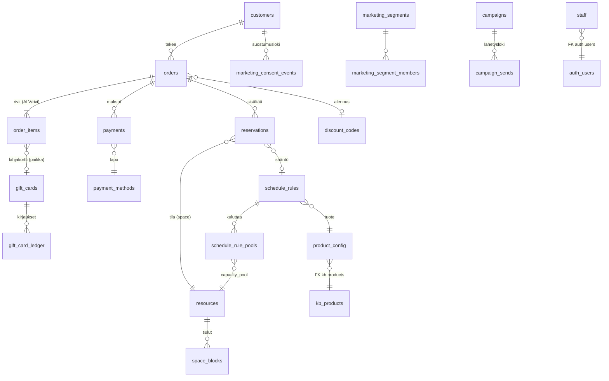

# Oma varausjärjestelmä (korvaa Johkun) – Sipoonjoen perinnesauna

Kevyt, nopea ja helposti muokattava varausjärjestelmä: **Supabase (Postgres, skeema `booking`) + staattinen kauppa + staattinen hallinta**.
Ei palvelinkoodia, ei build-vaihetta selaimen koodille, ei kirjastoriippuvuuksia. Kaikki säännöt (kapasiteetit, vuorot, hinnat) ovat dataa.

> Tila: **ei tuotannossa**. Visma Pay -maksut, sähköpostiviestit, lahjakortit, hoidot ja tapahtumat on rajattu pois ensimmäisestä vaiheesta (ks. [Puuttuu](#puuttuu-ja-seuraavat-vaiheet)).

## Sisältö

| Polku | Mitä |
|---|---|
| `supabase/migrations/` | 9 SQL-migraatiota (skeema `booking`). **Ainoa tapa muuttaa tuotantokantaa.** |
| `supabase/tests/` | pgTAP-testit + kilpailutilannetesti (`run.sh`), mock-Supabase ja mock-kb |
| `supabase/manual/` | Käsin tehtävät vaiheet: skeeman avaus REST:iin, ensimmäinen admin, tarkistuskyselyt |
| `shared/sb.js` | ~110 rivin PostgREST/Auth-asiakas (käytetään kaupassa ja hallinnassa) |
| `shop/` | Varauskauppa: **kopio uudesta sivustosta**, jossa Johku-linkit avaavat sisäisen kalenterin |
| `admin/` | Hallinta-SPA (mobiili ensin + työpöytä), Supabase Auth |
| `dev/` | Paikallinen demo: PostgREST-konfiguraatio, kehityspalvelin (mock-auth), demo-siemen |
| `scripts/e2e-screenshots.mjs` | Playwright-savutesti + kuvakaappaukset + konsolivirhetarkistus |
| `docs/` | Maksurajapinta, Johku-tuonti, ristiriidat ja tulkinnat, Bottiavustuspyyntö, kuvakaappaukset |

## Arkkitehtuuri



* **Kauppa (anon)** käyttää vain 6 julkista RPC-funktiota: `public_catalog`, `public_availability`, `public_create_booking`, `public_get_booking`, `public_cancel_booking`, `public_settings`. Suoraa taulu-oikeutta anonilla ei ole. Asiakastietoja ei voi lukea.
* **Hallinta (authenticated + `booking.staff`)** käyttää `admin_*`-funktioita ja RLS-suojattua lukua. Rooli `admin` / `staff` (ks. [docs/roolit-ja-kb.md](docs/roolit-ja-kb.md)).
* **Totuus tuotteille ja hinnoille on `kb`** (`kb.products`, `kb.product_price_variants`). Varausjärjestelmä lukee hinnat suoraan sieltä; hallinta muokkaa niitä rajatulla `SECURITY DEFINER` -funktiolla (vain admin, auditoitu, kirjaa myös `kb.change_log`).
* **Vuorot ja kapasiteetit ovat dataa** (`schedule_rules`, `resources`), vuoroinstanssit lasketaan lennossa (`booking._sessions`). Ei etukäteen luotuja vuoroja → ei ajastettuja generointiajoja.

### Miksi vanilla JS + staattinen (ei React/Vue)?
Sivusto on jo staattinen, nopea ja ilman riippuvuuksia. Kauppa ja hallinta ovat ~600 + ~900 riviä ES-moduuleja ilman build-vaihetta: avaat tiedoston, muokkaat, päivität selaimen. Ei `node_modules`-tuontia, ei haavoittuvuuspäivityksiä, Lighthouse-pisteet pysyvät ylhäällä, ja Pages-julkaisu pysyy ennallaan. Haittapuoli (ei komponenttikirjastoa) on tässä laajuudessa pieni; jos hallinta kasvaa selvästi, näkymät (`admin/views/*.js`) on helppo siirtää esim. Preactiin.

## Tietomalli



Keskeiset taulut (kaikissa RLS päällä; tarkka rakenne migraatioissa 02–03):

* `customers` – yhteystiedot, `marketing_consent` + `_at` + `_source` + `_text_version`, `unsubscribe_token`, `external_source/external_id`, `anonymized_at` (GDPR).
* `orders` – `order_no` (alkaa 10001), `public_token` (vahvistussivun salainen linkki), `status`, `payment_status`, `total_gross`, `source_channel` (`web|admin|phone|email|walk_in|johku_import|other`), `external_source='johku'`, `external_id`, `johku_order_no`.
* `order_items` – rivikohtainen `vat_rate` (24 / 25.5 / 14 / 13.5 / 10 / 0), generoidut `line_net` / `line_vat`.
* `reservations` – `space_id`, `mode` (`shared`/`exclusive`), `starts_at/ends_at`, generoitu `during`, `persons`, `pool_ids` (kapasiteettipoolit, snapshot), `status`, `hold_expires_at`, `rule_id`.
* `payments` – `provider`, `provider_ref`, `status`, `method`, `amount`, `link_url`, `raw`.
* `discount_codes`, `gift_cards`, `gift_card_ledger` – alennus- ja lahjakorttipaikat (ei vielä käytössä kaupassa).
* `marketing_segments`, `marketing_segment_members`, `campaigns`, `campaign_sends` – markkinoinnin rakenne (ei vielä käytössä).
* `audit_log` – kaikkien keskeisten taulujen muutokset (trigger) + hallinnan kb-muutokset.

## Päällekkäisyyssäännöt (yksityinen ↔ yleinen) – miten varmistetaan

Kaikki yhdessä paikassa: trigger `booking.reservations_validate` (BEFORE INSERT/UPDATE, `migraatio 04`). Jokainen varaus (kauppa, hallinta, tuonti) kulkee sen läpi.

1. Trigger ottaa tilakohtaisen **advisory-lukon** (`pg_advisory_xact_lock('booking:space:<id>')`) → saman tilan varaukset käsitellään yksi kerrallaan.
2. Lukon sisällä tarkistetaan aktiiviset varaukset (`confirmed` tai `pending` jonka pito ei ole vanhentunut):
   * **yksityinen** + mikä tahansa aktiivinen päällekkäinen → virhe `public_shift_booked` / `private_booked`;
   * **yleinen** + aktiivinen yksityinen päällekkäin → `private_booked`;
   * **yleinen**: kapasiteettipoolien huippukuorma aikavälillä (sweep alkuhetkien yli) + henkilöt > pool → `capacity_exceeded`;
   * sulku (`space_blocks`) → `space_closed`.
3. Varalla **exclusion constraint** (`btree_gist`) estää kaksi yksityistä päällekkäin vaikka trigger ohitettaisiin.
4. Lukukysely (`_sessions`) laskee saman logiikan, joten kalenteri näyttää myös yksityisvuoron vaikutuksen ("Ei varattavissa") ja täydet vuorot.

Kapasiteetit (data, `resources` + `schedule_rule_pools`):

| Aika | Sääntö |
|---|---|
| ma–ke | 16 hlöä (pooli `yleinen_arki`) |
| to | Turvesauna 16–17: max 8 (pooli `turve`); yleinen 17–19; yhteensä max 16 (turve kuluttaa myös `yleinen_arki`-poolia) |
| la–su | Yleiset 2 h vuorot 14:00, 14:30, 15:00, (15:30 kesäkausi), 16:00, 16:30, 17:00; **6 hlöä sisällä yhtä aikaa** (pooli `yleinen_vkp`, limittäiset vuorot jakavat poolin); tunnin vuorot 14 ja 18 (18 €) jakavat saman 6:n |

Tulkinnat ja avoimet kysymykset: [docs/ristiriidat-ja-tulkinnat.md](docs/ristiriidat-ja-tulkinnat.md).

## Asennus (tuotanto)

**Edellytykset:** Supabase-projekti, jossa on `kb`-skeema (tuotteet, hintavariantit, sijainnit, `kb.change_log`).
**Kantaan kirjoittaa vain Bottiavustus** – migraatioita ei aja kukaan muu eikä mitään SQL:ää ajeta tuotantoon käsin muuten kuin `supabase/manual/`-tiedostoista.

### Migraatiojärjestys

| # | Tiedosto | Mitä tekee |
|---|---|---|
| 01 | `…_booking_01_core.sql` | Skeema `booking`, `btree_gist`, apufunktiot, `staff`, `settings`, `resources`, `product_config`, `audit_log`, roolifunktiot (`is_staff`, `is_admin`) |
| 02 | `…_booking_02_data_model.sql` | Asiakkaat, tilaukset, rivit, varaukset (exclusion constraint), maksut, lahjakortit, alennukset, markkinointi, rate limit |
| 03 | `…_booking_03_schedule_rules.sql` | Vuorosäännöt, kapasiteettipoolit, sulut |
| 04 | `…_booking_04_engine.sql` | Päällekkäisyys- ja kapasiteettilogiikka (trigger), vuorogeneraattori, vanhenevat pidot |
| 05 | `…_booking_05_booking_api.sql` | Julkiset RPC:t (validointi, rate limit, pito) |
| 06 | `…_booking_06_admin_api.sql` | `admin_*`-funktiot, kb-tuotemuokkaus, maksuadapterin funktiot (vain service_role) |
| 07 | `…_booking_07_rls_grants.sql` | RLS kaikkialla + minimioikeudet (revoke all → explicit grant) |
| 08 | `…_booking_08_seed_rules.sql` | Asetukset, resurssit, `product_config`, 31 vuorosääntöä kb:n pohjalta |
| 09 | `…_booking_09_cron_optional.sql` | (valinnainen) pg_cron-ajastus pitojen siivoukseen; ohitetaan jos pg_cron puuttuu |

Migraatiot **eivät muuta `kb`-skeemaa** (vain viittaavat siihen FK:lla ja funktiot kirjoittavat `kb.products`, `kb.product_price_variants`, `kb.change_log`). Roolit: ei uusia tietokantaroolia; käytetään Supabasen `anon`, `authenticated`, `service_role`.

Migraatioiden jälkeen (käsin, järjestyksessä):
1. `supabase/manual/01_expose_schema.md` – lisää `booking` Exposed schemas -listalle.
2. `supabase/manual/02_first_admin.sql` – luo käyttäjä Authissa ja lisää `booking.staff`-rivi (admin).
3. `supabase/manual/03_verify.sql` – tarkistukset.
4. Rakenna kauppa ja hallinta (alla) ja julkaise.

### Kauppa

```bash
BOOKING_SUPABASE_URL=https://<ref>.supabase.co \
BOOKING_ANON_KEY=<anon/publishable-avain> \
SITE_URL=https://<julkinen-osoite> \
node booking/shop/build.mjs        # → booking/shop/dist/  (koko sivusto + varauskauppa)
```

Kauppa on sivuston kopio: `scripts/build.mjs` ajetaan erilliseen hakemistoon ja Johku-linkit (`*.johku.com/<kieli>/<kategoria>/<tuote>`) korvataan sisäisillä (`/varaa/#/tuote/<slug>`). Lahjakortti-, yritys- ja info-linkit jäävät toistaiseksi Johkuun (ei vielä toteutettu). Perussivuston tiedostoihin ei kosketa; `booking/shop/dist` on `.gitignore`ssa (`dist/`).
Ajonaikainen konfiguraatio on tiedostossa `dist/booking/config.js` (voi vaihtaa ilman uudelleenrakennusta).

### Hallinta

Staattinen: kopioi `admin/` + `shared/sb.js` palvelimelle (esim. `/hallinta/`; älä linkitä julkisesta sivustosta, `noindex` on päällä):

```bash
mkdir -p out/hallinta && cp -r booking/admin/* out/hallinta/ && cp booking/shared/sb.js out/hallinta/sb.js
cp out/hallinta/config.example.js out/hallinta/config.js   # täytä url + anonKey
```

### Ympäristömuuttujat / avaimet

| Muuttuja | Missä | Huom |
|---|---|---|
| `BOOKING_SUPABASE_URL`, `BOOKING_ANON_KEY` | kaupan build, `config.js` | anon/publishable-avain saa olla julkinen |
| `BOOKING_REST`, `BOOKING_AUTH`, `BOOKING_SCHEMA` | kaupan build | oletus `/rest/v1`, `/auth/v1`, `booking` |
| `SITE_URL`, `SITE_ENV` | sivuston build | kuten nykyinen build (`SITE_ENV=test` → noindex) |
| service role -avain | **ei koskaan selaimessa** | vain tulevalle Visma Pay -callback-funktiolle (palvelinpuoli) |
| `PGHOST/PGPORT/PGUSER/PGPASSWORD`, `BOOKING_TEST_DB` | testit | paikallinen testikanta |

## Paikallinen demo

Vaatii PostgreSQL 15+ (`btree_gist`), [PostgREST](https://postgrest.org) ja Node 20.

```bash
# 1) kanta: mock-Supabase + kb (oikea tuotedata, ei asiakkaita) + migraatiot + demo-siemen (keksittyjä @example.com-asiakkaita)
PGHOST=127.0.0.1 PGPORT=54329 PGUSER=postgres booking/dev/setup-db.sh
# 2) REST
postgrest booking/dev/postgrest.conf &
# 3) kauppa + kehityspalvelin (staattiset + PostgREST-proxy + mock-kirjautuminen)
BOOKING_SUPABASE_URL= BOOKING_ANON_KEY=demo node booking/shop/build.mjs
node booking/dev/server.mjs        # http://localhost:4180/  ja  /admin/   (admin@demo.local / staff@demo.local, salasana: demo)
# 4) kuvakaappaukset + konsolivirhetarkistus
PW_DIR=/polku/node_modules node booking/scripts/e2e-screenshots.mjs
```

Kuvakaappaukset: [`docs/screenshots/`](docs/screenshots/).

## Testit

```bash
PGHOST=127.0.0.1 PGPORT=54329 PGUSER=postgres booking/supabase/tests/run.sh
```
Vaatii PostgreSQL + pgTAP. Luo kannan `booking_test`, lataa mock-Supabasen (roolit `anon/authenticated/service_role`, `auth.uid()/auth.jwt()`), mock-kb:n (oikea tuotedata), kaikki migraatiot ja ajaa:

* `01_security` – RLS kaikissa tauluissa, `search_path` kaikissa funktioissa, anonin/staffin/ei-staffin oikeudet, ei vuotoja
* `02_overlap_rules` – yksityinen ↔ yleinen molempiin suuntiin (to, la–su), sulut, peruutus, vanhenevat pidot
* `03_capacity` – ma–ke 16, to turve 8 + yleinen = 16, la–su 6 yhtä aikaa limittäisillä vuoroilla
* `04_public_api` – validointi, hinnoittelu, rate limit, tokenilla haku ei vuoda henkilötietoja, asiakas-upsert, suostumuslogi
* `05_admin` – roolit, kb-tuotemuokkaus (+ audit + `kb.change_log`), manuaalivaraus, maksut, maksuadapteri, asiakashaku
* `race.sh` – rinnakkaiset yhteydet (anon) yrittävät varata samaa aikaa yhtä aikaa (advisory-lock-portti); invariantit: ei yksityisen ja yleisen päällekkäisyyttä, kapasiteetti ei ylity
* `mutation_check.sh` – todistaa että kilpailutesti on herkkä: poistaa lukon testikannasta ja odottaa `race.sh`:n epäonnistuvan

## Sääntöjen muuttaminen

Kaikki data, ei koodia. Muutos tehdään **uudella migraatiotiedostolla** (`supabase/migrations/<aikaleima>_*.sql`), jonka Bottiavustus ajaa.

```sql
-- Viikonlopun samanaikainen enimmäismäärä 6 → 8
update booking.resources set capacity = 8 where code = 'yleinen_vkp';          -- (tai hallinnan Resurssit-näkymästä)

-- Uusi yleinen vuoro la–su klo 18:30 (2 h) – jakaa viikonlopun poolin
with p as (select id from booking.resources where code = 'yleinen_vkp'),
     r as (insert into booking.schedule_rules (product_id, label, mode, space_id, weekdays, start_time, duration_minutes, price_mode, deadline_minutes, sort_order)
           select 1, 'Yleinen vuoro la–su 18:30 (2 h)', 'shared', (select id from booking.resources where code = 'savusauna'), '{6,7}', '18:30', 120, 'per_person', 15, 100 returning id)
insert into booking.schedule_rule_pools (rule_id, pool_id) select r.id, p.id from r, p;

-- Sulje vuoro pysyvästi / väliaikaisesti
update booking.schedule_rules set active = false where id = 9;                    -- tai valid_to = '2026-08-31'
```
Hinnat ja tuotetekstit **eivät** ole sääntöjä: ne muokataan hallinnan Tuotteet-näkymästä (kb on totuus). Vuoroaikojen ja kapasiteettien muutos vaikuttaa vain tuleviin varauksiin; olemassa olevat varaukset säilyvät (poolit tallennetaan varaukselle).

## Puuttuu ja seuraavat vaiheet

* **Visma Pay** – ei toteutettu (vain taulut, adapterifunktiot ja `pay_later`/`hold_until_paid` -tilat), ks. [docs/maksut-visma-pay.md](docs/maksut-visma-pay.md)
* Sähköpostivahvistukset ja muistutukset (viestipalvelu)
* Lahjakortit (taulut valmiina), alennuskoodit (taulu valmiina), tuotesarjat/vuosikortti
* Hoidot, saunotukset, rituaalit, tapahtumat (kalenteri- ja resurssimalli: hoitajat `person`-resursseina – tyyppi on jo skeemassa)
* Yritysvaraukset / tarjouspyynnöt
* Johku-tuonti (rakenne valmis: `external_source`, `johku_order_no`, `payment_methods.johku_codes`) – ks. [docs/johku-tuonti.md](docs/johku-tuonti.md)
* Markkinointilähetykset (segmentit/kampanjat: vain rakenne)
* Kaupan EN-käännökset tuotteille (`name_en`/`description_en` kb:ssä osin tyhjiä)

## Avoimet kysymykset

Ks. [docs/ristiriidat-ja-tulkinnat.md](docs/ristiriidat-ja-tulkinnat.md) (yhteenveto raportissa).
