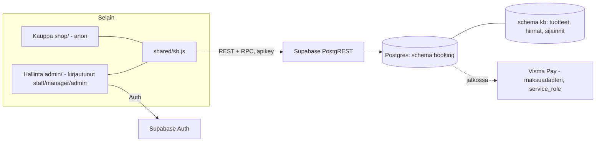
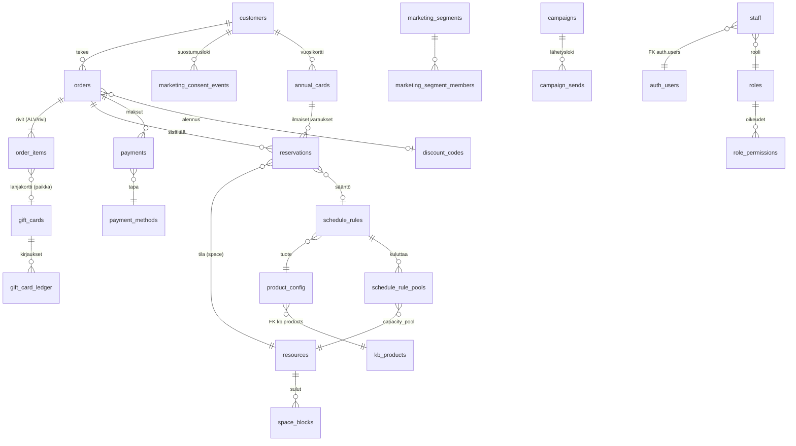

# Oma varausjärjestelmä (korvaa Johkun) – Sipoonjoen perinnesauna

Kevyt, nopea ja helposti muokattava varausjärjestelmä: **Supabase (Postgres, skeema `booking`) + staattinen kauppa + staattinen hallinta**.
Ei palvelinkoodia, ei build-vaihetta selaimen koodille, ei kirjastoriippuvuuksia. Kaikki säännöt (kapasiteetit, vuorot, hinnat) ovat dataa.

> Tila: **ei tuotannossa**. Visma Pay -maksut, sähköpostiviestit, lahjakortit, hoidot ja tapahtumat on rajattu pois ensimmäisestä vaiheesta (ks. [Puuttuu](#puuttuu-ja-seuraavat-vaiheet)).

## Sisältö

| Polku | Mitä |
|---|---|
| `supabase/migrations/` | 11 SQL-migraatiota (skeema `booking`; 01–09 ajettu testikantaan 16.10., 10 ja 11 odottavat ajoa). **Ainoa tapa muuttaa tuotantokantaa.** |
| `supabase/tests/` | pgTAP-testit + kilpailutilannetesti (`run.sh`), mock-Supabase ja mock-kb |
| `supabase/manual/` | Käsin tehtävät vaiheet: skeeman avaus REST:iin, ensimmäinen admin, tarkistuskyselyt |
| `shared/sb.js` | ~110 rivin PostgREST/Auth-asiakas (käytetään kaupassa ja hallinnassa) |
| `shop/` | Varauskauppa: **kopio uudesta sivustosta**, jossa Johku-linkit avaavat sisäisen kalenterin |
| `admin/` | Hallinta-SPA (mobiili ensin + työpöytä), Supabase Auth. Näkymät: Päivä (+ lisäpalvelujen "Valmistele"-yhteenveto), Varaukset, **Kalenteri** (työvuorot + varaukset), Uusi varaus (asiakastyyppi, lisäpalvelut), Asiakkaat (**Lisää asiakas**: yksityinen/yritys), Tuotteet (+ **Lisäpalvelut**), Resurssit, Asetukset, **Käyttäjät** (vain admin) |
| `supabase/functions/admin-users/` | Edge Function (Deno, `verify_jwt = true`): käyttäjien kutsu, käytöstä poisto ja aktivointi. Validointilogiikka `logic.js` + testit |
| `dev/` | Paikallinen demo: PostgREST-konfiguraatio, kehityspalvelin (mock-auth), demo-siemen |
| `scripts/e2e-screenshots.mjs` | Playwright-savutesti + kuvakaappaukset + konsolivirhetarkistus |
| `scripts/e2e-shop-layout.mjs` | Kaupan varauslomakkeen ja päivänäkymän (`#/paiva/<pvm>`) asettelutesti (360/390/430/1280 px, FI+EN, yksityinen+yritys; kosketuskohteet, kontrasti, näppäimistö): ei vaakavieritystä, osiot samassa linjassa, järjestys ja otsikot |
| `docs/` | Maksurajapinta, Johku-tuonti, ristiriidat ja tulkinnat, Bottiavustuspyyntö, kuvakaappaukset |

## Arkkitehtuuri



* **Kauppa (anon)** käyttää vain 7 julkista RPC-funktiota: `public_catalog`, `public_availability`, `public_create_booking`, `public_get_booking`, `public_change_booking`, `public_cancel_booking` (vain maksamattoman pidon vapautus), `public_settings`. Suoraa taulu-oikeutta anonilla ei ole. Asiakastietoja ei voi lukea.
* **Asiakas ei peruuta vahvistettua varausta itse.** Peruutukset sähköpostilla henkilökunnalle, joka peruu hallinnasta. Asiakas voi sen sijaan **muuttaa** varausta kauppasivulla (token-linkki): siirtää toiselle vapaalle vuorolle (sama tuote) tai muuttaa henkilömäärää, viimeistään 48 h ennen vuoron alkua (asetus `customer_change_hours_before`). Muutos on atomistinen ja noudattaa samoja lukkoja ja sääntöjä kuin uusi varaus (kapasiteetti, yksityinen ↔ yleinen -päällekkäisyys).
* **Hallinta (authenticated + `booking.staff`)** käyttää `admin_*`-funktioita ja RLS-suojattua lukua. Roolit `admin` (kaikki), `manager` = ylläpitäjä (hinnat, kuvaukset, asetukset, resurssit, vuorosäännöt, vuosikortit) ja `staff` = peruskäyttäjä (varaukset, asiakkaat, maksut, sulut). Roolit ja oikeudet ovat tauluja (`roles`, `role_permissions`); uusi rooli = INSERT. Ks. [docs/roolit-ja-kb.md](docs/roolit-ja-kb.md).
* **Vuosikortti:** `annual_cards`; vuosikorttiasiakas varaa ilmaiseksi (0 €) vain yleisiä vuoroja, yksi tuleva varaus kerrallaan, ei yksityisvuoroja (pakotus varausmoottorissa). Itsepalvelua ei vielä ole, mutta `customers.auth_user_id` on valmiina.
* **Totuus tuotteille ja hinnoille on `kb`** (`kb.products`, `kb.product_price_variants`). Varausjärjestelmä lukee hinnat suoraan sieltä; hallinta muokkaa niitä rajatulla `SECURITY DEFINER` -funktiolla (oikeus `catalog.edit`: manager ja admin; auditoitu, kirjaa myös `kb.change_log`).
* **Vuorot ja kapasiteetit ovat dataa** (`schedule_rules`, `resources`), vuoroinstanssit lasketaan lennossa (`booking._sessions`). Ei etukäteen luotuja vuoroja → ei ajastettuja generointiajoja.

### Miksi vanilla JS + staattinen (ei React/Vue)?
Sivusto on jo staattinen, nopea ja ilman riippuvuuksia. Kauppa ja hallinta ovat ~600 + ~900 riviä ES-moduuleja ilman build-vaihetta: avaat tiedoston, muokkaat, päivität selaimen. Ei `node_modules`-tuontia, ei haavoittuvuuspäivityksiä, Lighthouse-pisteet pysyvät ylhäällä, ja Pages-julkaisu pysyy ennallaan. Haittapuoli (ei komponenttikirjastoa) on tässä laajuudessa pieni; jos hallinta kasvaa selvästi, näkymät (`admin/views/*.js`) on helppo siirtää esim. Preactiin.

## Tietomalli



Keskeiset taulut (kaikissa RLS päällä; tarkka rakenne migraatioissa 02–03):

* `customers` – yhteystiedot, `marketing_consent` + `_at` + `_source` + `_text_version`, `unsubscribe_token`, `external_source/external_id`, `anonymized_at` (GDPR).
* `orders` – `order_no` (alkaa 10001), `public_token` (vahvistussivun salainen linkki), `status`, `payment_status`, `total_gross`, `source_channel` (`web|admin|phone|email|walk_in|johku_import|other`), `external_source='johku'`, `external_id`, `johku_order_no`.
* `order_items` – rivikohtainen `vat_rate` (24 / 25.5 / 14 / 13.5 / 10 / 0), generoidut `line_net` / `line_vat`.
* `reservations` – `space_id`, `mode` (`shared`/`exclusive`), `starts_at/ends_at`, generoitu `during`, `persons`, `pool_ids` (kapasiteettipoolit, snapshot), `status`, `hold_expires_at`, `rule_id`.
* `payments` – `provider`, `provider_ref`, `status`, `method`, `amount`, `link_url`, `raw`.
* `discount_codes`, `gift_cards`, `gift_card_ledger` – alennus- ja lahjakorttipaikat (ei vielä käytössä kaupassa).
* `marketing_segments`, `marketing_segment_members`, `campaigns`, `campaign_sends` – markkinoinnin rakenne (ei vielä käytössä).
* `roles`, `role_permissions` – roolit (admin, manager, staff + ei-henkilöstö customer, annual_card) ja niiden oikeudet; `staff.role` viittaa rooliin.
* `annual_cards` – asiakkaan vuosikortti (`valid_from/valid_to`, `active`); `customers.customer_type` ja `customers.auth_user_id` (tuleva itsepalvelu); `reservations.annual_card_id`.
* `audit_log` – kaikkien keskeisten taulujen muutokset (trigger) + hallinnan kb-muutokset.
* `customer_kinds` – asiakastyypit taulupohjaisesti (`private` = yksityisasiakas, `company` = yritysasiakas). `customers.customer_kind` + `business_id` (y-tunnus), `einvoice_address` (verkkolaskuosoite/OVT), `einvoice_operator` (välittäjätunnus), `invoice_reference`; osoite käyttää sarakkeita `company, address, zip, city, country`. **`customer_type` (customer/annual_card) on eri akseli** (etuustaso), `customer_kind` kertoo yksityinen vs. yritys. `orders.customer_kind`, `orders.billing` (laskutustietojen kuva tilaushetkeltä) ja `orders.invoice_reference` säilyttävät tilauksen laskutustiedot, vaikka asiakasrekisteri myöhemmin muuttuisi.
* `addons` – lisäpalvelut: `price_gross` (sis. ALV, kuten kaikki hinnat), `vat_rate`, `max_per_person`, `applies_modes` (yleinen/yksityinen vuoro), `active`. Tilauksella lisäpalvelu on `order_items`-rivi (`kind='addon'`, `addon_id`, `parent_item_id` = varausrivi), joten summa, ALV-erittely ja vuorokohtainen yhteenveto tulevat samasta rivitaulusta. Hinta kopioituu riville tilaushetkellä (hinnanmuutos ei muuta vanhoja tilauksia).

## Päällekkäisyyssäännöt (yksityinen ↔ yleinen) – miten varmistetaan

Kaikki yhdessä paikassa: trigger `booking.reservations_validate` (BEFORE INSERT/UPDATE, `migraatio 04`). Jokainen varaus (kauppa, hallinta, tuonti) kulkee sen läpi.

1. Trigger ottaa tilakohtaisen **advisory-lukon** (`pg_advisory_xact_lock('booking:space:<id>')`) → saman tilan varaukset käsitellään yksi kerrallaan.
2. Lukon sisällä tarkistetaan aktiiviset varaukset (`confirmed` tai `pending` jonka pito ei ole vanhentunut):
   * **yksityinen** + mikä tahansa aktiivinen päällekkäinen → virhe `public_shift_booked` / `private_booked`;
   * **yleinen** + aktiivinen yksityinen päällekkäin → `private_booked`;
   * **yleinen**: kapasiteettipoolien huippukuorma aikavälillä (sweep alkuhetkien yli) + henkilöt > pool → `capacity_exceeded`;
   * sulku (`space_blocks`) → `space_closed`.
3. Varalla **exclusion constraint** (`btree_gist`) estää kaksi yksityistä päällekkäin vaikka trigger ohitettaisiin.
4. Lukukysely (`_sessions`) laskee saman logiikan, joten kalenteri näyttää myös yksityisvuoron vaikutuksen ("Ei varattavissa") ja täydet vuorot.

Kapasiteetit (data, `resources` + `schedule_rule_pools`):

| Aika | Sääntö |
|---|---|
| ma–ke | 16 hlöä (pooli `yleinen_arki`) |
| to | Turvesauna 16–17: max 8 (pooli `turve`); yleinen 17–19; yhteensä max 16 (turve kuluttaa myös `yleinen_arki`-poolia) |
| la–su 2 h vuorot | Alkuajat 14:00, 14:30, 15:00, 16:00, 16:30, 17:00 (viimeinen päättyy 19:00); **6 hlöä PER ALKAMISAIKA** – jokaisella alkamisajalla oma pooli `yleinen_vkp_1400` … `yleinen_vkp_1700` (6 hlö), alkamisajat eivät jaa paikkoja. 15:30 ei ole alkuaika. |
| la–su 1 h vuorot | 14:00 ja 18:00 (Johku 152, 18 €): **10 hlöä / vuoro**, omat poolit `tunti_vkp_1400` ja `tunti_vkp_1800`; ei jaa paikkoja 2 h vuorojen kanssa |
| yksityinen ↔ yleinen | Yksityinen ja yleinen vuoro eivät saa olla päällekkäin kumpaankaan suuntaan (myös 1 h vuorot); yksikin yleisen vuoron varaus estää päällekkäisen yksityisvuoron |

Tulkinnat ja avoimet kysymykset: [docs/ristiriidat-ja-tulkinnat.md](docs/ristiriidat-ja-tulkinnat.md).

## Asennus (tuotanto)

**Edellytykset:** Supabase-projekti, jossa on `kb`-skeema (tuotteet, hintavariantit, sijainnit, `kb.change_log`).
**Kantaan kirjoittaa vain Bottiavustus** – migraatioita ei aja kukaan muu eikä mitään SQL:ää ajeta tuotantoon käsin muuten kuin `supabase/manual/`-tiedostoista.

### Migraatiojärjestys

| # | Tiedosto | Mitä tekee |
|---|---|---|
| 01 | `…_booking_01_core.sql` | Skeema `booking`, `btree_gist`, apufunktiot, `roles` + `role_permissions`, `staff`, `settings`, `resources`, `product_config`, `audit_log`, roolifunktiot (`is_staff`, `is_admin`, `has_permission`) |
| 02 | `…_booking_02_data_model.sql` | Asiakkaat, tilaukset, rivit, varaukset (exclusion constraint), maksut, vuosikortit, lahjakortit, alennukset, markkinointi, rate limit |
| 03 | `…_booking_03_schedule_rules.sql` | Vuorosäännöt, kapasiteettipoolit, sulut |
| 04 | `…_booking_04_engine.sql` | Päällekkäisyys- ja kapasiteettilogiikka (trigger; poolikohtainen kapasiteetti, vuosikorttisäännöt), vuorogeneraattori, vanhenevat pidot |
| 05 | `…_booking_05_booking_api.sql` | Julkiset RPC:t (validointi, rate limit, pito, varauksen muutos 48 h) |
| 06 | `…_booking_06_admin_api.sql` | `admin_*`-funktiot (oikeustarkistus roolin oikeuksilla), kb-tuotemuokkaus, vuorosääntöjen muokkaus, varauksen muutos, vuosikortit, käyttäjähallinta (`admin_set_staff_role`, `admin_link_public_staff`…), työvuorojen lukunäkymä `admin_upcoming_shifts` (lukee `public`-skeemaa, ei kirjoita), `svc_*` (vain service_role, Edge Function), maksuadapterin funktiot (vain service_role) |
| 07 | `…_booking_07_rls_grants.sql` | RLS kaikkialla + minimioikeudet (revoke all → explicit grant) |
| 08 | `…_booking_08_seed_rules.sql` | Asetukset, resurssit (poolit), `product_config`, 30 vuorosääntöä kb:n pohjalta (13 yleistä + 17 yksityistä) |
| 09 | `…_booking_09_cron_optional.sql` | (valinnainen) pg_cron-ajastus pitojen siivoukseen; ohitetaan jos pg_cron puuttuu |
| 10 | `…_booking_10_rls_initplan.sql` | Suorituskyky: RLS-politiikat `(select auth.uid())` / `(select booking.is_staff())` -muotoon (advisor `auth_rls_initplan`); sama semantiikka, idempotentti. Ei muokkaa migraatioita 01–09 |
| 11 | `…_booking_11_customer_kinds_addons.sql` | Asiakastyypit (`customer_kinds`, yritysasiakkaan y-tunnus + verkkolaskutiedot, tilauksen laskutustietojen kuva), lisäpalvelut (`addons`, `order_items.kind='addon'`), `public_addons`, `public_create_booking` (+ asiakastyyppi, yritystiedot, lisäpalvelut), `admin_create_customer`, `admin_set_reservation_addons`, `admin_get_order`, `admin_list/create/update_addon` (`catalog.edit`), `admin_day_view` (+ "valmistele"-yhteenveto). Ei muokkaa migraatioita 01–10 eikä `kb`-skeemaa |

Migraatiot **eivät muuta `kb`-skeemaa** (vain viittaavat siihen FK:lla ja funktiot kirjoittavat `kb.products`, `kb.product_price_variants`, `kb.change_log`). Roolit: ei uusia tietokantaroolia; käytetään Supabasen `anon`, `authenticated`, `service_role`.

Migraatioiden jälkeen (käsin, järjestyksessä):
1. `supabase/manual/01_expose_schema.md` – lisää `booking` Exposed schemas -listalle.
2. `supabase/manual/02_first_admin.sql` – luo Joonakselle käyttäjä Authissa ja aja YKSI lohko (admin, Joonas.vaarala@gmail.com); muut roolit on kommentoitu. Muut käyttäjät kutsutaan hallinnan Käyttäjät-näkymästä.
3. Edge Function `admin-users`: salaisuudet + deploy, ks. [Edge Function](#edge-function-admin-users) ja [docs/bottiavustus-pyynto.md](docs/bottiavustus-pyynto.md).
4. `supabase/manual/03_verify.sql` – tarkistukset.
5. Rakenna kauppa ja hallinta (alla) ja julkaise.

### Kauppa

```bash
BOOKING_SUPABASE_URL=https://<ref>.supabase.co \
BOOKING_ANON_KEY=<anon/publishable-avain> \
SITE_URL=https://<julkinen-osoite> \
node booking/shop/build.mjs        # → booking/shop/dist/  (koko sivusto + varauskauppa)
```

Kauppa on sivuston kopio: `scripts/build.mjs` ajetaan erilliseen hakemistoon ja Johku-linkit (`*.johku.com/<kieli>/<kategoria>/<tuote>`) korvataan sisäisillä (`/varaa/#/tuote/<slug>`). Lahjakortti-, yritys- ja info-linkit jäävät toistaiseksi Johkuun (ei vielä toteutettu). Perussivuston tiedostoihin ei kosketa; `booking/shop/dist` on `.gitignore`ssa (`dist/`).
Ajonaikainen konfiguraatio on tiedostossa `dist/booking/config.js` (voi vaihtaa ilman uudelleenrakennusta).

#### Kaksi tapaa selata: kategorioittain ja päivän mukaan

Kaupan etusivulla (`/varaa/`, `/en/book/`) on valinta **Selaa kategorioittain** (oletus; tuote → päivä → vuoro, reitit `#/` ja `#/tuote/<slug>/<pvm>` ennallaan) ja **Selaa päivän mukaan** (reitti `#/paiva/<YYYY-MM-DD>`, linkitettävissä):
* Viikkoliuska (ma–su, merkkinä vapaa / täynnä / ei varattavissa, nuolet viikon vaihtoon), "Tänään"-painike ja päivävalitsin (`<input type=date>`) kuukausien välillä liikkumiseen. Menneet päivät ja varausikkunan (`booking_horizon_days`) jälkeiset päivät eivät ole valittavissa.
* **Tuotteet ensin, ajat vasta valinnan jälkeen:** valitulle päivälle näytetään ensin vain ne tuotteet, joilla on vähintään yksi varattavissa oleva vuoro (ryhmittelynä Yleiset vuorot / Yksityisvuorot / Muut): nimi, lyhyt kuvaus, hinta (alk. tai € / hlö) ja tiivistelmä ("N aikaa vapaana · ensimmäinen klo hh"). Täynnä olevat ja ei varattavissa olevat tuotteet jätetään pois. Ajat (alkamis- ja päättymisaika, vapaita paikkoja / Täynnä / Ei varattavissa, hinta ja **Valitse**) aukeavat vasta kun tuotekortti avataan.
* **Valinta: accordion (ei erillistä alinäkymää).** Kortti avautuu paikallaan, joten päivävalitsin pysyy näkyvissä ja päivän vaihto on yhden napautuksen päässä; erillinen alinäkymä veisi sivun alkuun ja vaatisi ylimääräisen Takaisin-askeleen mobiilissa. Saavutettavuus: kortin otsikko on `<button aria-expanded aria-controls>`, paneeli `role=region aria-labelledby`, Enter/väli avaa ja sulkee. Kaikki kortit ovat oletuksena kiinni, yksi auki kerrallaan; jos päivällä on vain yksi saatavilla oleva tuote, se on valmiiksi auki.
* **Tila URL:ssa:** `#/paiva/<pvm>?tuote=<slug>` avaa kyseisen kortin. Valitse-linkki (`?via=day`) vie lomakkeelle (`#/varaa/<rule_id>/<pvm>/<tuote-id>?via=day`), ja lomakkeen Takaisin palaa osoitteeseen `#/paiva/<pvm>?tuote=<slug>` eli samaan päivään ja samaan avoimeen korttiin.
* Tyhjä päivä (ei yhtään saatavilla olevaa tuotetta): "Ei vapaita vuoroja valitulle päivälle." + ehdotus seuraavasta päivästä, jolla on vapaita vuoroja (haetaan enintään 3 kuukautta eteenpäin).
* **Haku:** ei SQL-muutoksia. `public_availability(p_product_id, p_from, p_to)` on tuotekohtainen, joten päivänäkymä kutsuu sitä kullekin kaupan tuotteelle rinnakkain koko kuukauden väliltä (1 kutsu / tuote / kuukausi; viikon yli kuukauden rajan 2 kuukautta). Tulokset välimuistitetaan (`state.months`, sama kuin tuotenäkymässä), joten päivän vaihto samassa kuukaudessa ei kutsu palvelinta. Jos tuotteita tulee paljon, kannattaa lisätä migraatio (Bottiavustus), jossa on `public_availability_all(p_from date, p_to date)` (kaikki tuotteet yhdellä kutsulla); frontend vaihtuisi yhteen kutsuun muuttamalla vain `ensureMonths`-funktiota.

### Hallinta

Staattinen: kopioi `admin/` + `shared/sb.js` palvelimelle (esim. `/hallinta/`; älä linkitä julkisesta sivustosta, `noindex` on päällä):

```bash
mkdir -p out/hallinta && cp -r booking/admin/* out/hallinta/ && cp booking/shared/sb.js out/hallinta/sb.js
cp out/hallinta/config.example.js out/hallinta/config.js   # täytä url + anonKey
```

Kaupan ja hallinnan saa yhdellä komennolla samaan julkaisuun: `node scripts/build-pages.mjs` (ks. [Testiversion julkaisu](../README.md#testiversion-julkaisu-github-pages) juuri-READMEssä). Skripti generoi `hallinta/config.js`:n rakennusajan ympäristömuuttujista.

### Asiakastyypit ja lisäpalvelut (migraatio 11)

* **Asiakastyyppi** valitaan kaupassa (`/varaa/`, `/en/book/`), hallinnan Uusi varaus -lomakkeella ja Asiakkaat → **Lisää asiakas** -ikkunassa: *yksityisasiakas* (nimi, sähköposti, puhelin kuten ennen) tai *yritysasiakas* (yrityksen nimi, **y-tunnus** + tarkistenumero, katuosoite/postinumero/postitoimipaikka, valinnaiset verkkolaskutiedot: verkkolaskuosoite/OVT + operaattorin välittäjätunnus – vain yhdessä –, valinnainen viite/tilausnumero, yhteyshenkilön nimi/puhelin/sähköposti). Validointi on selaimessa ja tietokannassa (sama sääntö); kauppa ja hallinta kutsuvat samoja funktioita (`public_create_booking` / `admin_create_customer` / `admin_create_booking`).
* **Lisäpalvelut** (alussa *Turvenaamio ja jalkakylpy* 15 €, *Saunavihta* 13 €; hinnat sis. ALV 25,5 %): asiakas valitsee määrän (0 … henkilömäärä × `max_per_person`, oletus 1/hlö, max 99) kaupassa tai henkilökunta hallinnassa; hinta lisätään tilauksen summaan ja tilaukselle tulee oma `order_items`-rivi/lisäpalvelu. Päivänäkymä näyttää *Valmistele*-yhteenvedon vuoroittain ja koko päivälle sekä merkinnän varauksilla; varauksen tiedoissa näkyvät lisäpalvelut, yritysasiakkaan laskutustiedot ja *Muokkaa lisäpalveluita*. Lisäpalvelujen ylläpito (nimi, kuvaus FI/EN, hinta, ALV, enimmäismäärä, vuorotyypit, aktiivisuus): hallinta → Tuotteet → Lisäpalvelut, oikeus `catalog.edit` (manager, admin). Tulkinnat ja avoimet kysymykset: [docs/ristiriidat-ja-tulkinnat.md](docs/ristiriidat-ja-tulkinnat.md#g-asiakastyypit-ja-lisäpalvelut-migraatio-11-v8).
* RPC:t: julkiset `public_addons()`, `public_create_booking(…, p_customer_kind, p_company, p_addons)`, `public_get_booking` (+ `addons`); hallinta `admin_create_customer`, `admin_update_customer`, `admin_list_customers`, `admin_get_order`, `admin_set_reservation_addons`, `admin_list_addons`, `admin_create_addon`, `admin_update_addon`, `admin_create_booking(…, p_addons, p_invoice_reference)`, `admin_day_view` (+ `prep`, `addon_totals`).

### Edge Function `admin-users`

Kutsu sähköpostilla, käytöstä poisto/aktivointi (Auth-esto) – tarvitsee service role -avaimen, joten se ajetaan **palvelimella** (Supabase Edge Function), ei selaimessa.
Kutsuja tunnistetaan omalla JWT:llään (`booking.is_admin()`), sen jälkeen säännöt ja audit-loki tulevat `booking.svc_*`-funktioista.

| Muuttuja | Mistä |
|---|---|
| `SUPABASE_URL`, `SUPABASE_ANON_KEY`, `SUPABASE_SERVICE_ROLE_KEY` | Supabase asettaa automaattisesti Edge Functioneille |
| `ALLOWED_ORIGINS` | käsin: sallitut originit (esim. `https://<hallinta>`; GitHub Pages -testissä `https://joonasvaarala.github.io` – vain origin, ei polkua), ei jokerimerkkiä |
| `SITE_URL` / `INVITE_REDIRECT_URL` | käsin: kutsulinkin kohde. `INVITE_REDIRECT_URL` käytetään sellaisenaan (ensisijainen); jos puuttuu, kohde on `SITE_URL/hallinta/`. Lisättävä myös Authin *Redirect URLs* -listaan |

```bash
cd booking     # supabase/config.toml: verify_jwt = true
supabase secrets set ALLOWED_ORIGINS="https://<hallinta>" SITE_URL="https://<sivusto>" --project-ref <ref>
supabase functions deploy admin-users --project-ref <ref>
node --test supabase/functions/admin-users/logic.test.js      # yksikkötestit (myös: deno test …)
```
Hallinnan `config.js`:ssä oletus `functions: '/functions/v1'`. Paikallisessa demossa kehityspalvelin tarjoaa **mock-version** samasta rajapinnasta (sama `logic.js` ja samat tietokantafunktiot; kutsulinkki palautetaan vastauksessa sähköpostin sijaan).

### Roolit, käyttäjät ja työvuorot

* `admin` – kaikki, myös **Käyttäjät** (kutsu, rooli, käytöstä poisto, linkitys työntekijään). `manager` – ylläpito + kaikkien työvuorot, **ei** käyttäjähallintaa. `staff` – varaukset + omat työvuorot. Ks. [docs/roolit-ja-kb.md](docs/roolit-ja-kb.md).
* **Kalenteri** (kuukausi/viikko): työvuorot sinisellä, varaukset vihreällä; päivän klikkaus näyttää tiedot. Työvuorot luetaan `public`-skeemasta (Työvuoro-Tapio; vain luku, **muokkausta ei ole**) funktiolla `admin_upcoming_shifts` – oletetut sarakenimet ja niiden tarkistus: [docs/roolit-ja-kb.md](docs/roolit-ja-kb.md#oletetut-public-sarakkeet-varmistettava-ennen-migraatioiden-ajoa). Jos vuorodataa ei saada, varaukset näkyvät silti ja näytetään huomautus.
* Staff näkee vain omat vuoronsa, kun hänen käyttäjänsä on linkitetty työntekijään (Käyttäjät → Työntekijä).

### Ympäristömuuttujat / avaimet

| Muuttuja | Missä | Huom |
|---|---|---|
| `BOOKING_SUPABASE_URL`, `BOOKING_ANON_KEY` | kaupan build, `config.js` | anon/publishable-avain saa olla julkinen |
| `BOOKING_REST`, `BOOKING_AUTH`, `BOOKING_SCHEMA` | kaupan build | oletus `/rest/v1`, `/auth/v1`, `booking` |
| `SITE_URL`, `SITE_ENV` | sivuston build | kuten nykyinen build (`SITE_ENV=test` → noindex) |
| service role -avain | **ei koskaan selaimessa** | vain tulevalle Visma Pay -callback-funktiolle (palvelinpuoli) |
| `PGHOST/PGPORT/PGUSER/PGPASSWORD`, `BOOKING_TEST_DB` | testit | paikallinen testikanta |

## Paikallinen demo

Vaatii PostgreSQL 15+ (`btree_gist`), [PostgREST](https://postgrest.org) ja Node 20.

```bash
# 1) kanta: mock-Supabase + kb (oikea tuotedata, ei asiakkaita) + migraatiot + demo-siemen (keksittyjä @example.com-asiakkaita)
PGHOST=127.0.0.1 PGPORT=54329 PGUSER=postgres booking/dev/setup-db.sh
# 2) REST
postgrest booking/dev/postgrest.conf &
# 3) kauppa + kehityspalvelin (staattiset + PostgREST-proxy + mock-kirjautuminen)
BOOKING_SUPABASE_URL= BOOKING_ANON_KEY=demo node booking/shop/build.mjs
node booking/dev/server.mjs        # http://localhost:4180/  ja  /admin/   (admin@demo.local / staff@demo.local, salasana: demo)
# 4) kuvakaappaukset + konsolivirhetarkistus
PW_DIR=/polku/node_modules node booking/scripts/e2e-screenshots.mjs
PW_DIR=/polku/node_modules node booking/scripts/e2e-shop-layout.mjs   # kaupan lomakkeen asettelu eri leveyksillä
```

Kuvakaappaukset: [`docs/screenshots/`](docs/screenshots/).

## Testit

```bash
PGHOST=127.0.0.1 PGPORT=54329 PGUSER=postgres booking/supabase/tests/run.sh
```
Vaatii PostgreSQL + pgTAP. Luo kannan `booking_test`, lataa mock-Supabasen (roolit `anon/authenticated/service_role`, `auth.uid()/auth.jwt()`), mock-kb:n (oikea tuotedata), `public`-skeeman mockin (`fixtures/public_mock.sql`: työvuorotaulut, ei GRANTteja), kaikki migraatiot ja ajaa:

* `01_security` – RLS kaikissa tauluissa, `search_path` kaikissa funktioissa, anonin/staffin/ei-staffin oikeudet, ei vuotoja
* `02_overlap_rules` – yksityinen ↔ yleinen molempiin suuntiin (to, la–su, 1 h vuorot mukaan lukien), sulut, peruutus, vanhenevat pidot
* `03_capacity` – ma–ke 16, to turve 8 + yleinen = 16, la–su 6 / alkamisaika (15:30 ei tarjolla), 1 h vuorot 10 / vuoro omana kapasiteettinaan
* `04_public_api` – validointi, hinnoittelu, rate limit, tokenilla haku ei vuoda henkilötietoja, asiakas-upsert, suostumuslogi
* `05_admin` – roolit, kb-tuotemuokkaus (+ audit + `kb.change_log`), manuaalivaraus, maksut, maksuadapteri, asiakashaku
* `06_roles` – roolitaulut, admin/manager/staff-oikeusmatriisi (staff ei voi päivittää hintaa, manager voi, manager ei voi muokata henkilöstöä tai antaa admin-oikeutta), viimeisen adminin suojaus, uusi rooli ilman koodimuutosta
* `07_change_booking` – asiakkaan varauksen muutos (`public_change_booking`): vuoron vaihto, henkilömäärä, 48 h raja (rajatapaukset), kapasiteetti ja päällekkäisyys molempiin suuntiin, atomisuus, `admin_change_booking`
* `08_annual_card` – vuosikortti: vain yleinen vuoro, 0 €, yksi tuleva varaus kerrallaan, ohitusyritykset suoraan tietokannassa, myöntö/peruutus, RLS
* `09_users_shifts` – työvuorojen lukunäkymä (staff vain omat, manager kaikki, ei oikeutta → virhe, väli > 62 pv → virhe, ei vuotavia kenttiä), roolin vaihdon ja linkityksen suojat (ei itseä, ei viimeistä adminia, epäaktiivinen/tuntematon kohde, vain staff-rooli, sama työntekijä kahdelle), `svc_*`-funktiot (vain service_role, säännöt, audit), ei kirjoituksia `public`-skeemaan
* `supabase/functions/admin-users/logic.test.js` – Edge Functionin validointi (rooli-sallittulista, syötteet, CORS, kutsulinkin osoite, virhekartoitus); `node --test` tai `deno test`
* `11_customer_kinds_addons` – asiakastyypit (y-tunnuksen tarkistenumero ja normalisointi, yritystietojen validointi, tuplien esto, yksityinen ≠ yritys samalla sähköpostilla, laskutustietojen kuva tilauksella), lisäpalvelujen hinnoittelu ja tilaus (summat, ALV-osuus, määrärajat, passiivinen/tuntematon/väärä vuorotyyppi), muutos lisäpalveluiden kanssa (rajaus, maksetun tilauksen hintatarkistus), hallinnan oikeudet (`catalog.edit`: staff ei, manager/admin kyllä), päivänäkymän "valmistele"-yhteenveto, RLS-eristys ja sisäisten funktioiden oikeudet
* `10_rls_initplan` – politiikkojen lausekkeissa ei ole suoraa `auth.uid()`/`is_staff()`/`has_permission()`-kutsua ilman `select`-kääreitä; politiikkojen määrä ja oikeudet (staff/manager/admin/anon) ennallaan
* `race.sh` – rinnakkaiset yhteydet yrittävät varata samaa aikaa yhtä aikaa (advisory-lock-portti); invariantit: ei yksityisen ja yleisen päällekkäisyyttä, kapasiteetti ei ylity (ma–to 16, la–su 6 / alkamisaika, 1 h vuoro 10, poolit riippumattomia), vuosikortilla vain yksi tuleva varaus, asiakkaan rinnakkaiset muutokset eivät ylitä kapasiteettia eivätkä riko päällekkäisyyssääntöä
* `mutation_check.sh` – todistaa että kilpailutesti on herkkä: poistaa lukon testikannasta ja odottaa `race.sh`:n epäonnistuvan

## Sääntöjen muuttaminen

Kaikki data, ei koodia. Pienet muutokset (kapasiteetit, sääntöjen nimi/päällä/pois, henkilömäärät, deadline, voimassaolo, asetukset) voi tehdä hallinnan Resurssit- ja Asetukset-näkymistä (manager ja admin). Uudet vuorot ja aikataulumuutokset tehdään **uudella migraatiotiedostolla** (`supabase/migrations/<aikaleima>_*.sql`), jonka Bottiavustus ajaa. Viikonlopun 2 h vuoron kapasiteetti on poolikohtainen: jokaisella alkamisajalla on oma pooli (`yleinen_vkp_HHMM`).

```sql
-- Viikonlopun yhden alkamisajan (14:00) kapasiteetti 6 → 8
update booking.resources set capacity = 8 where code = 'yleinen_vkp_1400';        -- (tai hallinnan Resurssit-näkymästä)

-- Uusi yleinen vuoro la–su klo 18:30 (2 h) – oma kapasiteettipooli (6 hlö / alkamisaika)
with p as (insert into booking.resources (code, name, kind, parent_id, capacity, notes, sort_order)
           select 'yleinen_vkp_1830', 'La–su 2 h vuoro 18:30 (paikat / vuoro)', 'capacity_pool', id, 6, 'Viikonlopun 2 h yleinen vuoro klo 18:30: 6 hlö per vuoro.', 39
             from booking.resources where code = 'savusauna' returning id),
     r as (insert into booking.schedule_rules (product_id, label, mode, space_id, weekdays, start_time, duration_minutes, max_persons, price_mode, deadline_minutes, sort_order)
           select 1, 'Yleinen vuoro la–su 18:30 (2 h)', 'shared', (select id from booking.resources where code = 'savusauna'), '{6,7}', '18:30', 120, 6, 'per_person', 15, 100 returning id)
insert into booking.schedule_rule_pools (rule_id, pool_id) select r.id, p.id from r, p;

-- Sulje vuoro pysyvästi / väliaikaisesti
update booking.schedule_rules set active = false where id = 9;                    -- tai valid_to = '2026-08-31'
```
Hinnat ja tuotetekstit **eivät** ole sääntöjä: ne muokataan hallinnan Tuotteet-näkymästä (kb on totuus). Vuoroaikojen ja kapasiteettien muutos vaikuttaa vain tuleviin varauksiin; olemassa olevat varaukset säilyvät (poolit tallennetaan varaukselle).

## Puuttuu ja seuraavat vaiheet

* **Visma Pay** – ei toteutettu (vain taulut, adapterifunktiot ja `pay_later`/`hold_until_paid` -tilat), ks. [docs/maksut-visma-pay.md](docs/maksut-visma-pay.md)
* Sähköpostivahvistukset ja muistutukset – **avoin, ei toteutettu**. Suunnitelma: lähetys osoitteesta savusauna@saunotus.fi Supabase Edge Functionilla ja transaktiosähköpostipalvelulla (valitaan myöhemmin). Siihen asti vahvistus näkyy vain sivulla ja peruutukset tulevat sähköpostilla.
* Vuosikorttiasiakkaan itsepalvelu (kirjautuminen) – rakenne valmis (`customers.auth_user_id`, `annual_card`-rooli), ei toteutettu
* Lahjakortit (taulut valmiina), alennuskoodit (taulu valmiina), tuotesarjat
* Hoidot, saunotukset, rituaalit, tapahtumat (kalenteri- ja resurssimalli: hoitajat `person`-resursseina – tyyppi on jo skeemassa)
* Yritysvaraukset / tarjouspyynnöt
* Johku-tuonti (rakenne valmis: `external_source`, `johku_order_no`, `payment_methods.johku_codes`) – ks. [docs/johku-tuonti.md](docs/johku-tuonti.md)
* Markkinointilähetykset (segmentit/kampanjat: vain rakenne)
* Kaupan EN-käännökset tuotteille (`name_en`/`description_en` kb:ssä osin tyhjiä)

## Avoimet kysymykset

Ks. [docs/ristiriidat-ja-tulkinnat.md](docs/ristiriidat-ja-tulkinnat.md) (yhteenveto raportissa).
