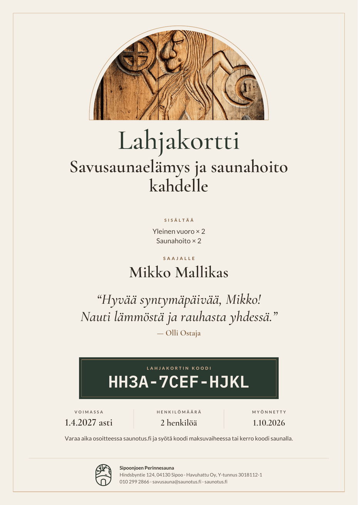
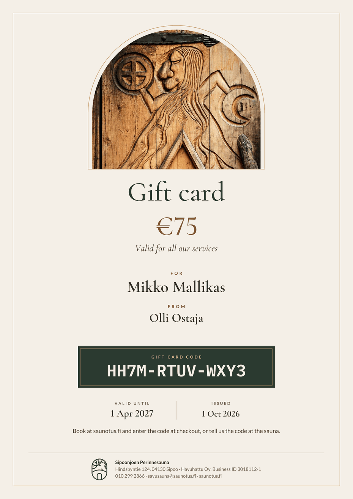

# Lahjakortin PDF-pohja (ulkoasu ja toteutus)

Tila: edge function `gift-card-pdf` on tuotannossa (vaihe 2, sopimus §13.9, migraatio `booking_45`). **Ulkoasu uusittu 17.10.2026** (PR `lahjakortti-pdf-design`): A5 vaaka → **A4 pysty**, sivuston oma ilme ja oven veistoskuva. Toteutus: `supabase/functions/gift-card-pdf/` (`render.ts` = pdf-lib + fontkit, `index.ts` = HTTP-rajapinta, `fonts.ts` / `photos.ts` = upotetut fontit ja kuva, `assets/build_assets.py` = niiden generointi). Tuotantoon julkaisu (edge-funktion deploy) tehdään erikseen.

Esimerkit (oikean `render.ts`:n tuottamat PDF:t kuvina): `lahjakortti-pdf-pohja-fi.png` (paketti + tervehdys, **ei hintaa**), `lahjakortti-pdf-pohja-fi-pitka-tervehdys.png` (300 merkin tervehdys, paketti), `lahjakortti-pdf-pohja-fi-avoin.png` (avoin summakortti, hinta/arvo näkyy), `lahjakortti-pdf-pohja-en.png` (EN, avoin kortti), `lahjakortti-pdf-pohja-en-paketti.png` (EN, paketti). Kaikki tilat renderöi `deno run -A --node-modules-dir=none test_render.ts` (`OUT_DIR=…`).

## Muoto ja ulkoasu
- **A4 pysty** (595,28 × 841,89 pt), yksi sivu. Kaikki sisältö on tulostusmarginaalin sisällä (ei täysreunakuvaa tai -taustaa: kotitulostin jättää reunat valkoisiksi), ohut kultainen kehys 22 pt reunasta, pohjaväri hiekka `#F4EFE7`. Mustetta kuluu vähän.
- **Kaarikuva:** sivuston oven veistos (ei ihmiskuvaa) rajattuna kaareen, joka toistaa logon kaarimuotoa; ohut kultainen ääriviiva kuvan ympärillä. Kaaren korkeus joustaa sisällön mukaan (118–340 pt; matala kaari kapenee): lyhyt teksti → iso kuva, 300 merkin tervehdys → matalampi kuva. Kuva on JPG (780 × 867 px, ~185 kt), upotetaan PDF:ään kerran. Lähde `assets/ovi-kaari.jpg` (rajaus ja pakkaus; sama kuva kuin sivuston oviveistos, ei tekoälymuokkausta).
- Hierarkia ylhäältä alas, keskitetty: **Lahjakortti** (Cormorant Garamond 46 pt) → **lahjakorttipaketilla paketin nimi isosti (30 pt) + "Sisältää"-lista (max 4 riviä, `label × persons`, yksi per rivi) ja EI hintaa**; **avoimella summakortilla arvo isolla (kulta)** + "Käy kaikkiin palveluihimme" → **Saajalle** + nimi + **tervehdys** (kursiivi, lainausmerkeissä, keskitetty; koko 28 → 13 pt merkkimäärän ja tilan mukaan) + lahjoittaja ("— Nimi", tai ilman tervehdystä "Lahjoittaja" + nimi) → **koodilaatikko** (vihreä `#2B3A30`, koodi IBM Plex Mono SemiBold 28 pt, pienenee vain jos ei mahdu, ei alle 18 pt) → **Voimassa / Henkilömäärä / Saldo (vain jos ≠ arvo) / Myönnetty** kolmessa–neljässä sarakkeessa → käyttöohje → alatunniste (logo, nimi, osoite, yhtiö + Y-tunnus, puhelin, sähköposti, web).
- **Hintasääntö:** hinta/arvo näytetään vain avoimessa summakortissa (ja Johku-korvaavassa kortissa, jolla ei ole pakettia). Lahjakorttipaketilla hintaa ei näytetä PDF:ssä (eikä Saldo-solua), koska saaja ei saa nähdä pakettihintaa. Sääntö on `showsPrice(d)` (`render.ts`, testattu). Sama koskee saajan sähköpostia (`gift_card_recipient`: vain avoimen kortin arvo näkyy); ostajan vahvistuksessa (`gift_card_buyer`) ja tilaussivun/kaupan "Näytä koodi" -näkymässä (ostajalle) hinta saa näkyä.
- Tila: `expired` → "Vanhentunut"-leima, `used` → "Käytetty"-leima (kallistettu, kuvan päällä; EN: Expired/Used). Muuten sama pohja.
- Fontit (sivuston omat): **Cormorant Garamond** (otsikot, arvo, tervehdys; tasakorkeat numerot `lnum`), **Lato** (leipäteksti, kickerit), koodiin **IBM Plex Mono** (tasalevyinen; koodiaakkostossa ei ole I/O/1/0). Kaikki SIL OFL 1.1 -lisensoituja. `fonts.ts` sisältää niiden latin-1/WinAnsi-osajoukot (~200 kt base64; vain `kern`/`lnum`), joten PDF:ssä on oikeat upotetut fontit, ei Times/Helvetica. **WinAnsi-siivous säilyy**: `san()`/`sanGreeting()` korvaavat/poistavat emojit ja muut merkit, joita fontit eivät sisällä (emoji → `?`). Teksti on PDF:ssä oikeaa tekstiä (koodi kopioitavissa).
- Värit (kontrasti mitattu): ink `#2F2923`/hiekka 12,6:1; teksti `#4A3F35` 8,9:1; himmeä `#66594D` 5,9:1; kulta `#7A5530` 5,8:1; hiekka/vihreä 10,5:1; kicker `#E3C79A`/vihreä 7,4:1; leima `#8A2B1F`/kortti 8,0:1. Ei sinistä.
- Koko: PDF ~270 kt (kuva 185 kt, fontit ~30 kt, logo ~50 kt kun logo-URL toimii; ilman logoa ~220 kt). Renderöinti ~130–200 ms.
- Rajapinta ennallaan: `buildGiftCardPdf(d, logo?, langOverride?)` ja `index.ts` (GET `?t=<token>&lang=fi|en`).
- Kuvan/fonttien päivitys: muokkaa `assets/ovi-kaari.jpg` tai fonttilistaa ja aja `python3 assets/build_assets.py` (fonttools; `FONT_DIR` = Google Fonts -kansio).

## Tietolähde: `public_get_gift_card(p_public_token)` (sopimus §13.2)
| PDF-kenttä | RPC-kenttä | Huomio |
|---|---|---|
| Koodi | `code` (`XXXX-XXXX-XXXX`) | jo viivallinen; ei normalisoida uudelleen |
| Otsikko | `locale` (`fi`/`en`) | valitsee kielen: "Lahjakortti" / "Gift card" |
| Kicker | `kind`, `package_code` | `open` → "Avoin lahjakortti"; muuten "Lahjakorttipaketti" |
| Paketin nimi | `package.name` / `package.name_en` | avoimella kortilla: "Käy kaikkiin palveluihimme" / "Valid for all our services" |
| Sisältö / kuvaus | `package.items`, `package.description(_en)` | näytetään jos ei tyhjä (tuotannossa osa tyhjiä) |
| Arvo | `initial_amount`, `currency` | vain avoin kortti (ja Johku): arvo euroina; **paketilla ei näytetä** |
| Saldo | `balance` | vain jos hinta näytetään (avoin/Johku) ja `balance ≠ initial_amount` |
| Saaja | `recipient_name` | rivi piilotetaan jos tyhjä |
| Tervehdys | `greeting` (≤ 300 merkkiä) | rivinvaihdot säilytetään; **tyhjä → koko tervehdysosa piiloon** |
| Lahjoittaja | `buyer_name` | piilotetaan jos tyhjä |
| Voimassa | `valid_to` | Helsingin päivä; "asti" / "Valid until"; kortti käy koko päättymispäivän |
| Henkilömäärä | `package.persons` | vain paketeille |
| Myönnetty | `issued_at` | Helsingin päivä |
| Alapalkki | `seller` (`_seller()`) | nimi, osoite, puhelin, sähköposti |
| Tila | `status` | PDF vain `active`/`used`; `not_ready` (maksamaton) → ei PDF:ää; `expired` → "Vanhentunut"-leima |

## Tervehdyksen mahtuminen
Tervehdys ≤ 300 merkkiä. Asettelu mitataan kuivakierroksella (väliaikainen sivu): tervehdyksen koko valitaan merkkimäärän mukaan (≤ 45 merkkiä 28 pt, ≤ 100 24 pt, ≤ 180 21 pt, muuten 19 pt) ja pienennetään tarvittaessa 13 pt:aan, kunnes sisältö mahtuu kaaren vähimmäiskorkeudella (150 pt); loppu tila annetaan kaarikuvalle ja väleille. Rivitys on sanatasolla `widthOfTextAtSize`:lla (Cormorant on kapea: 300 merkkiä ≈ 5–6 riviä 19 pt:llä, 396 pt leveässä sarakkeessa); pitkä sana katkaistaan. Pitkä saajan nimi pienenee/jakautuu kahdelle riville, pitkä lahjoittaja pienenee tai katkaistaan "…":iin. Rivinvaihdot säilytetään (max 1 tyhjä rivi). Testattu: 300 merkin FI/EN-tervehdys, 300 × "W" ilman välilyöntejä, 80 merkin nimi, paketti jossa 4 sisältöriviä.

## Kytkentä kauppaan ja hallintaan (valmis)
- **Linkki:** `GET <SUPABASE_URL>/functions/v1/gift-card-pdf?t=<kortin public_token>&lang=fi|en` (`verify_jwt=false`, vain UUID-tokeni avaa; maksamaton/mitätöity kortti → 409, tuntematon token → 404; ei välimuistia). Selaimessa linkki muodostetaan `sb.js`:n `functionUrl`:lla samoin kuin `receipt-pdf`.
- **Tilaussivu** (`/tilaus/?t=…`, `/en/order/?t=…`): kortin koodin avauksen yhteydessä **"Lataa PDF"** / "Download PDF" (uusi välilehti) kun kortti on valmis (`ready`). `giftCardPdf` on `config.js`:ssä oletuksena `true` (`BOOKING_GIFT_CARD_PDF=0` tai `giftCardPdf: false` piilottaa napin; merkkijono = toisen funktion nimi). `lang` = sivun kieli. Myyntisivun "valmis"-paneelissa PDF-linkkiä ei ole: kortit ovat siinä vaiheessa maksamattomia (PDF antaisi 409); ostaja saa PDF:n sähköpostissa (`gift_card_buyer`) ja tilaussivulta.
- **Hallinta** (Talous › Lahjakortit › kortin tiedot): **"Avaa PDF"** / "Open PDF" uuteen välilehteen, vain jos `admin_get_gift_card().card.public_token` on olemassa; `lang` = hallinnan kieli. Tilassa `pending_payment`/`cancelled`/`pending_verification` nappi on pois käytössä (PDF antaisi 409) ja selitys näkyy; varmistamattomalla saldolla (`balance_verified=false`, Johku) näytetään varoitus. Johku-korttien korvaava PDF käyttää samaa koodia ja samaa pohjaa.
- **Sivun sisältölista:** myyntisivun paketeilla `items[].label` (FI) / `items[].label_en` (EN, migraatio 45).

## Avoimet kysymykset
1. ~~Logo~~: ratkaistu, `seller.logo_url` (PNG) piirretään alatunnisteeseen; ilman logoa PDF toimii (teksti keskittyy).
2. Ehdot/pienellä: tarvitaanko alapalkkiin lyhyt ehtoteksti (siirrettävyys, rahaksi vaihto, voimassaolon jatko) – teksti tulee Joonakselta, ei keksitä tässä.
3. Saajan sivu (`public_get_gift_card` toimii myös siihen): halutaanko sama sisältö verkkosivuna (`/lahjakortti/kortti/?t=…`)?
4. Jälkitarkistus julkaisun jälkeen: avaa tuotannossa yksi oikea kortti (`gift-card-pdf?t=…`) ja varmista, että `npm:@pdf-lib/fontkit` latautuu edge-ajoympäristössä (paikallisesti Deno-testattu).
