# Uudistuksen luonnokset kuvina

Kymmenen eniten muuttuvaa ja tärkeintä näkymää. Raportti: [docs/claude/2026-11-analyysi-sivut-ja-hallinta.md](../../claude/2026-11-analyysi-sivut-ja-hallinta.md) (luvut 1.6–1.8).

Violetit numerot selitetään kunkin kuvan alalaidassa ("Mitä muuttui"). Selitysten tunnisteet (esim. HALL-PAIVA-01) viittaavat raportin kohtiin. Nimet, numerot ja paikkamäärät ovat keksittyjä esimerkkejä. Klikattavat versiot ovat samassa kansiossa (`index.html`). Päivitetty 13.11.2026 palautteen mukaan.

## Hallinta

### 01 Päivänäkymä vastaanoton tabletilla
Valmistelu ylimpänä (henkilöt ja lisäpalvelut lajeittain), sisäänkirjausympyrä, uusi valikko (Koulutukset omana kohtanaan), Kassa yläpalkissa, rivin pikatoiminnot.

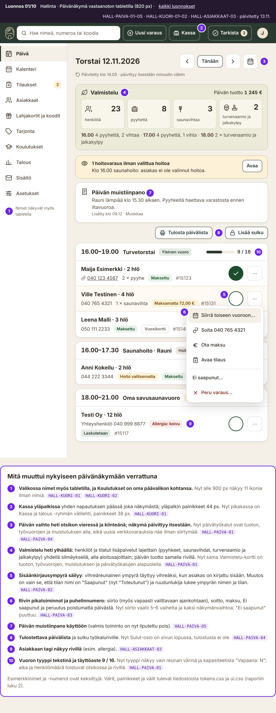

### 02 Tilausnäkymä
Kadonneet toiminnot takaisin, siirto uudella hinnalla ja ilmoituksella myös vapaaseen ajankohtaan, selkokielinen aikajana.

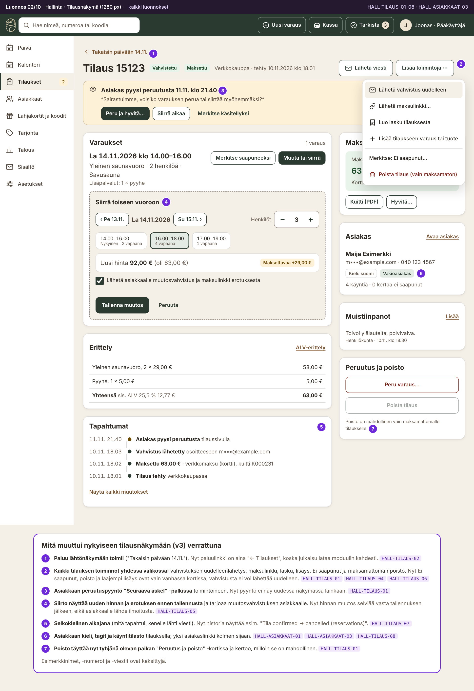

### 03 Aukiolot ja poikkeuspäivät (uusi)
Viikkopohja, vuoron muokkaus esikatselulla, kertavuorot, suljetut päivät ja päiväkohtainen kapasiteetti.

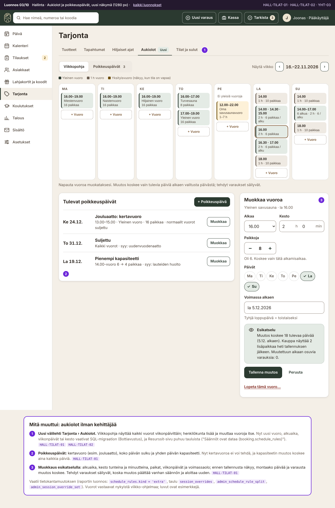

### 04 Tuotteen muokkaus
Oma näkymä välilehdillä, yksi näkyvyysvalinta, "Valmis verkkomyyntiin?" -tarkistus, yksi tallennuspalkki.

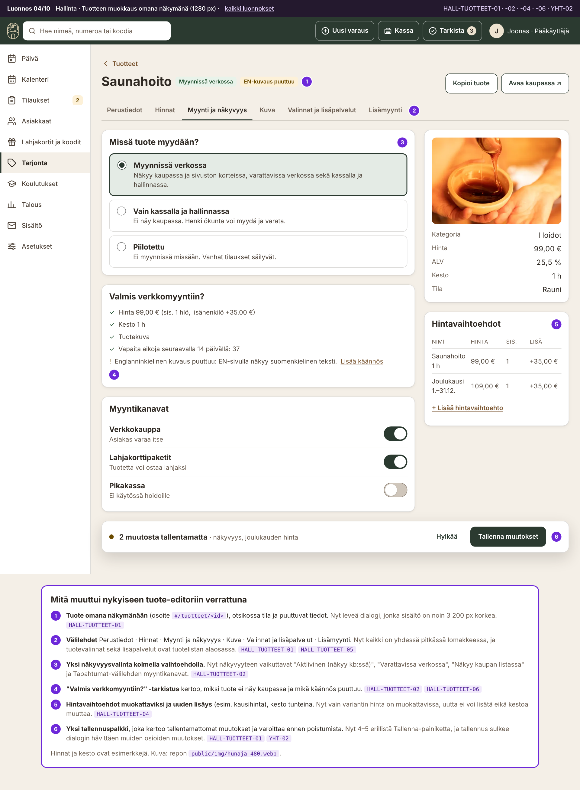

### 05 Pikakassa tabletilla
Ostoskori aina näkyvissä, korttipäätemaksun kuittaus, maksulinkki QR-koodina.

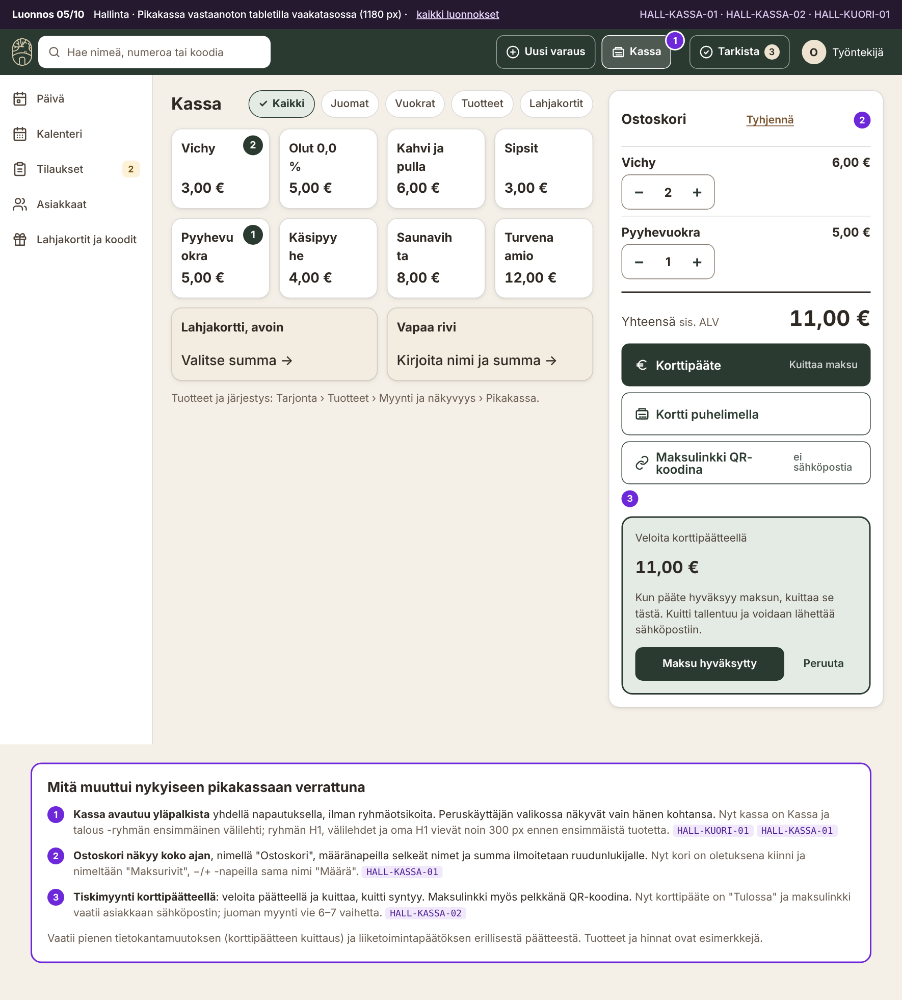

### 06 Asetukset puhelimella
5 välilehteä 10:n sijaan, tapahtumien myynnin kytkin, yksi tallennuspalkki.

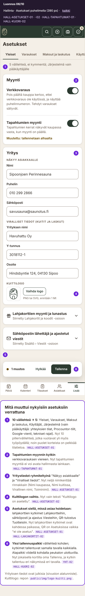

### 07 Tekstit (uusi)
Sivuston, kaupan ja sähköpostien tekstit FI/EN rinnakkain, tarkistus, esikatselu ja versiot.

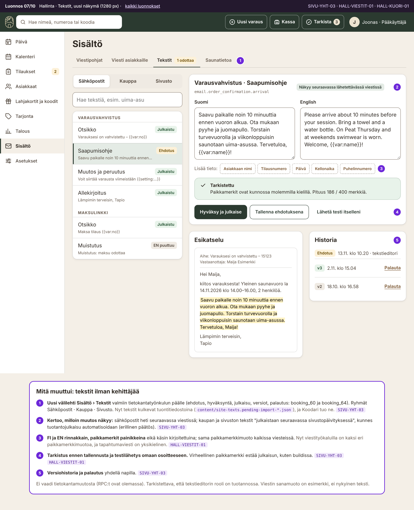

## Varauskauppa

### 08 Varauslomake puhelimella
Kiinteä summapalkki, virheet kentän alla, vaihepalkki.

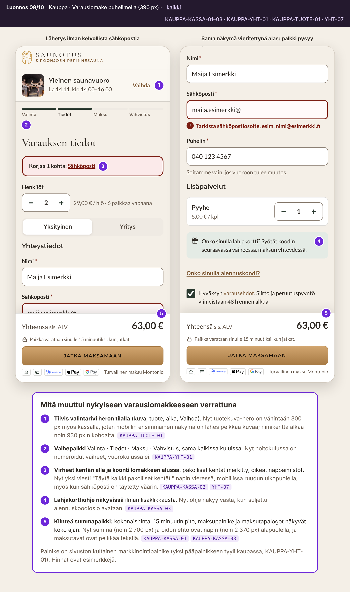

### 09 Vahvistussivu, kaksi tilaa
Yksi otsikko ja päätoiminto, "Hallitse varausta", selkeä vanhentunut tila.

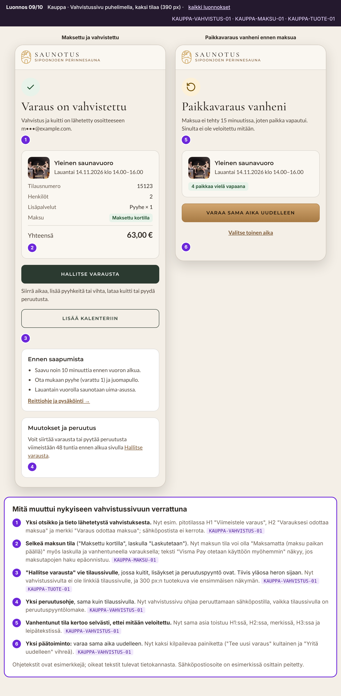

## Julkinen sivusto

### 10 Etusivu ja yleisilme
Varaa-painike aina näkyvissä, yksi otsikkokirjasin, tasaiset kortit, viikko-ohjelmassa vapaat paikat.

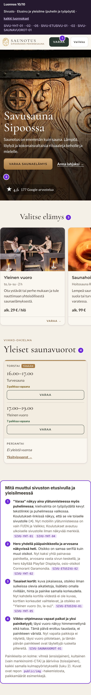

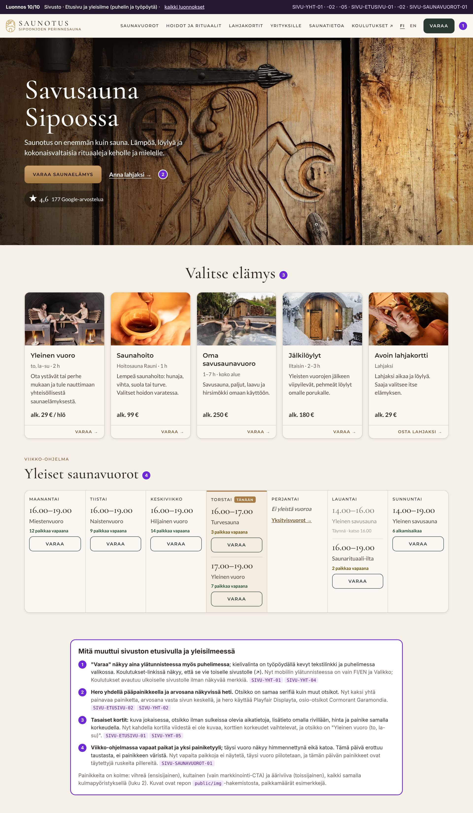
